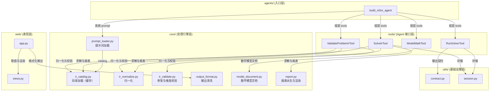
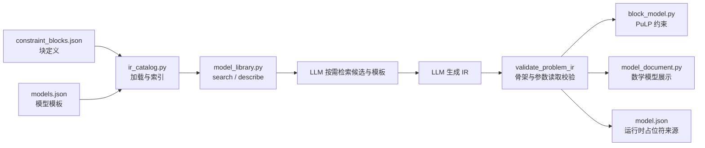

# NL2OR Agent

> 将自然语言运筹学问题转化为数学模型并自动求解的智能体，基于 [HAMLET](https://github.com/MINDS-THU/HAMLET) 框架构建，使用 [uv](https://github.com/astral-sh/uv) 管理依赖。

## 快速开始

### 1. 安装依赖

```bash
# 安装 uv（若尚未安装）
pip install uv

# 在 nl2or_agent 目录下初始化环境并安装依赖
cd nl2or_agent
uv sync
```

### 2. 配置环境变量

```bash
cp .env.example .env
# 编辑 .env，填入你的 LLM API Key
```

`.env` 示例：

```dotenv
HAMLET_MODEL_ID=openrouter/deepseek/deepseek-v4.1-flash   # 或 openrouter/anthropic/claude-3.5-sonnet
OPENROUTER_API_KEY=sk-or-xxx
# 可选：off 关闭模型的思考 token（该模型的思考占 completion 约八成，单步耗时主要由它决定）
HAMLET_REASONING=off
```

### 3. 运行

命令行模式（默认）：

```bash
uv run python main.py
# 或
uv run python main.py --mode cli

# 自动模式：粘贴完整需求，一轮内完成建模与求解
uv run python main.py --agent-mode automatic
```

| 模式 | 行为 | 适用场景 |
|------|------|---------|
| `interactive`（默认） | 每轮推进一个步骤：解析 → 用户确认 → 求解 | 需求含糊、需要逐步核对解析结果 |
| `automatic` | 一轮内完成解析、校验、建模与求解 | 需求完整、一次性提交 |

测试与 Web 界面：

```bash
uv run pytest tests/                # 集成测试
uv run python main.py --mode web    # Gradio 界面，说明见「使用 Gradio GUI」
```

## Benchmark 评测与结果

`benchmarks/` 提供五层评测，T1、T2、T4、T5 不依赖 LLM。块的语义只有一处实现（`core/block_model.py`），最优值来自独立求解与 OR-Library 的已发表值；用例 schema、命令与外部 benchmark 调研见 `benchmarks/README.md`。

最近一次真实评测（2026-10-26，`openrouter/deepseek/deepseek-v4.1-flash`，automatic 模式）：

| 层 | 命令 | 结果 |
|----|------|------|
| T1 IR 判定 | `uv run python benchmarks/run_benchmark.py` | 43/43 |
| T2 求解执行 | `--mode solver` | 29/29 |
| T3 端到端 | `--mode online --agent-mode automatic --repeats 3` | attempt 61/66（92.4%）；用例全过 17/22 |
| T4 紧约束 | `--mode tightness` | 17/17 |
| T5 情景对比 | `--mode what_if` | 19/19（43 个情景） |

T3 每次尝试同时要求：答复引用目标值（claim 95.5%），且落盘脚本重算一致（artifact 97.0%）。基础设施错误 0，time-to-success 172.2s，22 用例 × 3 次整轮 42.6 分钟，单次求解 6.8–113.8s。5 次失败尝试中，3 次为答复以「见上方输出」代替目标值（产物正确），2 次为落盘脚本未能复现答复数字（答复正确，单次现象）。

## 项目结构

```
nl2or_agent/
├── pyproject.toml          # uv 项目配置，依赖声明
├── .python-version         # Python 版本锁定（3.11）
├── .env.example            # 环境变量模板（复制为 .env 后填写）
├── main.py                 # 入口：--mode cli（默认）/ --mode web；--agent-mode interactive（默认）/ automatic
│
├── agents/
│   ├── __init__.py
│   ├── nl2or_agent.py      # build_nl2or_agent() / apply_agent_mode() — 组装与切换 CodeAgent
│   └── runtime.py          # CLI 与 Web 共用的单回合运行时
│
├── core/                   # 核心处理逻辑
│   ├── __init__.py
│   ├── _defaults.py        # 共享默认路径配置
│   ├── block_model.py      # 可执行块语义：IR → PuLP，求解与结果渲染
│   ├── ir_catalog.py       # 模型库/积木块目录加载（按文件状态缓存）
│   ├── ir_normalize.py     # Problem IR 归一化
│   ├── ir_validate.py      # 骨架与维度校验
│   ├── model_document.py   # IR → 数学模型文档（Markdown + LaTeX）
│   ├── model_library.py    # 模型库检索：候选索引与模板细节（按需两阶段）
│   ├── output_format.py    # agent 输出清洗与占位符展开
│   ├── problem_ir.py       # ProblemIR 值对象与 IR 词汇表（解析 / 参数覆盖）
│   ├── prompt_loader.py    # 提示词加载
│   ├── report.py           # 报表类型派生与渲染
│   └── what_if.py          # what_if skill：可算模型表（库派生）
│
├── tools/
│   ├── __init__.py
│   ├── ir_tools.py              # ValidateProblemIrTool / ModelMathTool
│   ├── model_library_tool.py    # SearchModelLibraryTool / DescribeModelTool
│   ├── solver_tool.py           # RunSolverTool — 执行生成的求解代码
│   └── solve_ir_tool.py         # SolveIrTool — 按 IR 求解单个情景
│
├── data/
│   ├── model_bank/
│   │   ├── models.json             # OR 模型模板库
│   │   └── constraint_blocks.json  # 约束积木块目录
│   └── workspace/          # 会话工作区（模型记录与求解脚本）
│
├── benchmarks/             # 五层评测：IR 判定 / 求解执行 / 端到端 / 紧约束分析 / 情景对比
│
├── utils/
│   ├── __init__.py
│   ├── contract.py         # 求解器输出契约（Objective: <值>）
│   └── session.py          # 会话工作区、模型产物与求解脚本存盘
│
├── web/
│   ├── __init__.py
│   ├── app.py              # Gradio 界面接线、对话轮次与 Agent 缓存
│   └── views.py            # 会话视图：模型对照与代码文件的取值与渲染
│
└── prompts/
    ├── system.prompt.md                 # 模式无关的系统提示词
    ├── workflow.interactive.prompt.md    # interactive 工作流
    ├── workflow.automatic.prompt.md      # automatic 工作流
    └── problem_ir_format.prompt.md       # Problem IR 格式说明
```

## 架构说明

### HAMLET 核心组件映射

| 流程图模块 | HAMLET 组件 | 本项目实现 |
|-----------|-------------|-----------|
| 交互核心 | `CodeAgent` | `agents/nl2or_agent.py` 中的 `build_nl2or_agent()` |
| LLM | `LiteLLMModel` | 通过 `HAMLET_MODEL_ID` 环境变量切换提供商 |
| IR 校验接口 | `Tool` 子类 | `tools/ir_tools.py` — `ValidateProblemIrTool` / `ModelMathTool` |
| 求解器接口 | `Tool` 子类 | `tools/solver_tool.py` — `RunSolverTool` |
| 情景求解接口 | `Tool` 子类 | `tools/solve_ir_tool.py` — `SolveIrTool`（按 IR 求解单个情景，不写脚本） |
| 代码生成器 | `CodeAgent` 内置 | CodeAgent 自带 Python 代码生成与执行能力 |
| 本地存储 | 文件系统 | `data/workspace/sessions/<会话>/`，保存模型记录与求解脚本 |
| 用户界面 | Gradio | `web/app.py` — 自建 Gradio 聊天界面 + `main.py --mode web` |

### 模块职责划分



| 模块 | 职责 | 内容 |
|------|------|------|
| `core/` | 处理引擎层 | `ir_catalog.py`（目录加载，按文件状态缓存）、`ir_normalize.py`（归一化）、`ir_validate.py`（骨架与维度校验）、`model_document.py`（数学模型文档）、`report.py`（报表派生与渲染）、`problem_ir.py`（IR 值对象与词汇表）、`block_model.py`（可执行块语义）、`output_format.py`（输出清洗）、`prompt_loader.py`（按模式组装提示词） |
| `tools/` | Agent 接口层 | HAMLET Tool 子类，薄封装调用 `core/` 函数 |
| `utils/` | 基础设施层 | `contract.py`（求解器输出契约）、`session.py`（会话管理） |
| `web/` | 表现层 | `app.py`（界面接线、对话轮次与 Agent 缓存）、`views.py`（会话视图取值与渲染） |
| `agents/` | 入口层 | `nl2or_agent.py`（组装 CodeAgent）、`runtime.py`（CLI 与 Web 共用的单回合运行时） |

### Agent 工作流

下图是 `interactive` 模式：解析与确认各占一个用户轮次，确认后进入求解。
`automatic` 模式在单轮内连续完成解析、校验与求解，只在最后给出一个 `final_answer`。

```
用户输入自然语言问题
        │
        ▼
  PARSING（CodeAgent 调用 LLM）
   ├─ 提取：问题类型 / 约束块 / 目标函数 / 参数
   └─ validate_problem_ir 归一与校验，追问用户确认
        │
        ▼
  CONFIRMING（用户确认或修改）
   ├─ 确认 ──► 进入 SOLVING
   └─ 修改 ──► 返回 PARSING
        │
        ▼
  SOLVING（SolveIrTool 按块语义求解）
   └─ 库外规则或用户要求手写代码时改用 RunSolverTool
        │
        ▼
  返回自然语言解释与数学模型
```

### 约束产生与上下文注入



| 阶段 | 承载者 | 内容 |
|------|--------|------|
| 定义 | `data/model_bank/constraint_blocks.json` | block_id、名称、语义、数学形式、参数、典型模型 |
| 按需检索 | `core/model_library.py` + `tools/model_library_tool.py` | `search_model_library` 候选索引、`describe_model` 模板必需骨架；提示词不含块目录 |
| 生成 | LLM | 按模板选择 block_id，题面额外限制写入 `custom_constraints` |
| 校验 | `validate_problem_ir` | 别名归一、参数检查、骨架检查、方向检查、参数读取检查 |
| 执行 | `core/block_model.py` | 按 block_id 调用 builder，生成 PuLP 约束 |
| 展示 | `core/model_document.py` | 用同一份数学形式生成 LaTeX 模型；最终答复由 `expand_placeholders` 从 model.json 与 solve_result.json 填充 |

`constraint_blocks` 的 `natural_language` 省略时由目录描述自动补齐，用于追溯约束来源。

### 自定义 Tool 开发指南

在 `hamlet.core.tools.Tool` 基础上继承即可：

```python
from hamlet.core.tools import Tool

class MyTool(Tool):
    name = "my_tool"
    description = "工具的功能描述（LLM 依此决定何时调用）"
    inputs = {
        "param_name": {
            "type": "string",
            "description": "参数说明",
        }
    }
    output_type = "string"

    def forward(self, param_name: str) -> str:
        # 实现工具逻辑，这个必须重载！
        return "结果"
```

然后在 `build_nl2or_agent()` 的 `tools` 列表中添加即可。

## 扩展指南

### 切换 LLM 提供商

修改 `.env` 中的 `HAMLET_MODEL_ID`，支持的格式遵循 [litellm](https://docs.litellm.ai/docs/providers) 规范：

思考型模型的 reasoning token 会把单步耗时拉长（实测占 completion 的八成）。`HAMLET_REASONING=off` 时通过 `extra_body={"reasoning": {"enabled": false}}` 关闭思考；改用 `reasoning_effort=` 无效，litellm 的模型表里没有这个 id，参数会在过滤阶段被丢掉。

### 添加新的 OR 模型模板

编辑 `data/model_bank/models.json`，按现有格式添加新条目。字段说明：

- `id`: 唯一标识符
- `class`: 问题分类，如 `location_problem`、`knapsack`、`general`
- `inherits`: 需要继承骨架时填写父族 id，如 `location_problem`
- `blocks`: 该模型自身的约束块 id 列表
- `objective_block`: 目标块 id
- `parameters`: 参数名、类型与是否必填

`models.json` 顶层的 `symbols` 保存参数符号映射，`model_document` 按该映射渲染公式中的符号。

约束块的数学形式、参数与可执行语义分别登记在 `constraint_blocks.json` 与 `core/block_model.py`。

### 使用 Gradio GUI

```bash
uv run python main.py --mode web
```

Web 界面支持聊天交互、求解器文件列表查看与会话级隔离（每个浏览器标签页一个独立 agent 实例）。
界面顶部的「模式」选择器在 `interactive` 与 `automatic` 之间切换，切换只替换系统提示词中的工作流部分，会话记忆保持。`--agent-mode` 决定界面打开时选中的模式。

三个标签页：

| 标签页 | 内容 |
|--------|------|
| 对话 | 聊天、模式选择；提交后自动刷新模型视图 |
| 模型 | 归一化 IR 与模板要求的逐块对照（命中 / 替代 / 缺失 / 额外）、目标块与方向、未绑定参数、库外规则、校验错误提示，以及归一化 IR 的 JSON |
| 代码 | agent 写出的求解脚本：选择、编辑、保存、原地重跑，输出含 `[RESULT] Objective: <值>` |

## 计划

- [x] **主循环模块撰写**：进行试验性质 User - 交互核心 - LLM 模块初步开发，验证核心流程的可行性与效果；
- [x] **验证核心求解闭环**：通过配置环境、修复沙箱与提示词格式，使得基础求解能力可用；
- [x] **前端增强**：在 Gradio 聊天界面上补充模型逐块对照与代码查看、重跑。

> 结构实现可以参考 `../docs/DESIGN.md` 中的设计方案（由于由大模型生成，不保证对），具体细节可根据实际开发进度进行调整与优化。

## 更新记录

- **2026-11-13** 修正「模型已变更」误报：`fixed_cost`/`demand` 等按键数据按实体顺序归一为列表；指纹改为只哈希可执行模型内容（忽略说明文字、块顺序、`missing_data`），并对 `[MODEL_MATH\]` 这类转义占位符做展开容忍。提示词新增「缺数据先反问」规则：必需数据缺失时不建模、不填占位，先列出缺失项；同时要求每条消息为单个 python 块、答复放在 `final_answer` 内。
- **2026-11-13** 模型输出解析加固：`_patch_hamlet_code_parsing` 在原始解析失败后依次解包 DSML 原生调用、裁掉空 Early Stop 段、按序合并多个代码块、兜底裸代码；提示词补充「代码不要携带 LaTeX 转义」。
- **2026-11-13** 数学模型补齐 s.t. 的变量取值范围：决策变量的 0-1 / 整数 / 非负数域以显式约束形式渲染（带 `\forall` 量词，位于结构约束与库外规则之后），不再只写在符号说明的变量定义里。
- **2026-11-12** 上下文与校验收紧：模型库退出系统提示词，改为 `search_model_library` / `describe_model` 两阶段按需检索（提示词 20.1k→14.2k 字符，与库规模解耦）；`validate_problem_ir` 报告只留结论（删除目录回显与 `constraint_context`）；未消费数值参数在 solve_ir 路径升级为错误；`custom_constraints` 只收题面额外限制；最终答复改由运行时占位符 `[MODEL_MATH]` / `[SOLVE_RESULT]` 从 model.json 与 solve_result.json（带 IR 指纹）填充；hamlet 系统提示词残留 print 静音，agent 按 UI 实际模式构造，`LITELLM_LOCAL_MODEL_COST_MAP=true` 跳过价格表远程拉取。本轮建立的绑定约定汇总在 `../docs/AGENT.md`。
- **2026-10-26** 组分削减：工具 7→4（删除模型库检索、块目录、脚本渲染工具）；IR 删除报表规格面与死字段；`schema/` 并入 `core/`；报表由块结构派生。
- **2026-10-26** 模型与报表：`model_document`（LaTeX 数学模型）、`model_math`、八类结果报表、`solve_ir` 结果报表；location 扩展 7 个模型与对应约束块，模型库 schema v2（`class`/`inherits` 分离）。
- **2026-10-22** 求解快路径：默认 `solve_ir` 按块语义求解并落盘脚本，`run_solver` 退为库外块与手写代码的退路；观测只保留 stdout 尾部 40 行；`HAMLET_REASONING=off` 关闭思考 token。
- **2026-10-15** 双模式（interactive/automatic）；模型骨架校验（约束块集合 + 目标函数）；`what_if` 参数情景；`core` 分层归位（`block_model` 从 benchmarks 迁入）。
- **2026-05-27** Schema/Core/Web 三层分离；`ir_processor` 拆分；输出清洗归位。
- **2026-04-22** 主循环闭环：CodeAgent 工具调用、沙箱依赖白名单、多轮记忆。
