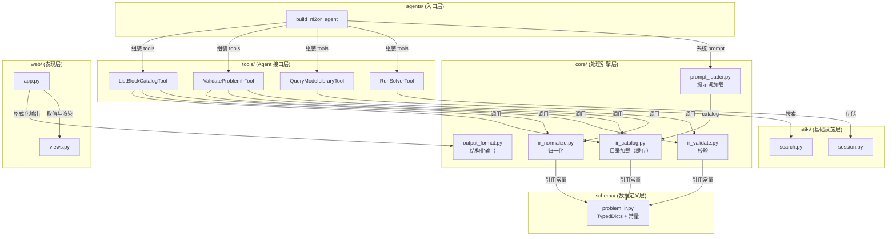

# NL2OR Agent

> 将自然语言运筹学问题转化为数学模型并自动求解的智能体，基于 [HAMLET](https://github.com/MINDS-THU/HAMLET) 框架构建，使用 [uv](https://github.com/astral-sh/uv) 管理依赖。

---

## 更新日志 (2026-10-15)

### 双模式：interactive 与 automatic

- **`prompts/` 按模式拆分**：抽出与模式无关的核心 prompt，工作流改为按模式加载
  - `system.prompt.md`：角色、输出约束、组合式建模、IR 构建与校验、求解（模式无关）
  - `workflow.interactive.prompt.md`：每轮推进一个步骤（解析 → 确认 → 查库 → 求解）
  - `workflow.automatic.prompt.md`：一轮内完成解析、查库、建模与求解
  - `problem_ir_format.prompt.md`：仅保留 IR 字段规范
- **`load_system_prompt(mode)`**：按模式组装系统提示词，未知模式直接抛 `ValueError`
- **`agents`**：`build_nl2or_agent(mode=...)` 在构建时选定模式；新增 `apply_agent_mode()`，在 `run()` 前切换模式（HAMLET 每次 `run()` 重读系统提示词，因此切换模式不会丢失会话记忆）
- **CLI**：新增 `--agent-mode {interactive,automatic}`，默认 `interactive`
- **Web**：新增模式选择器与模式说明，`_run_web(agent_mode)` 决定界面初始模式

### 模型骨架校验：约束集与目标函数

验收对象定为运筹模型的骨架（约束块集合与目标函数），与生成代码的写法无关。

- **目标函数不再被静默替换**（`core/ir_normalize.py`）：库中不认识的目标块保留原值并按库外目标记入提示；未声明目标只报提示，不再默认成 `weighted_service_distance_objective`；`sense` 由库中该目标块补全，与库冲突时报错
- **目标块有了优化方向**：`constraint_blocks.json` 的 5 个目标块补 `sense`，新增 `total_value_objective`（背包，maximize），`knapsack` 模型补 `objective_block`
- **骨架校验**（`validate_problem_ir`）：声明的族/模型所要求的约束块必须齐全（可用模板 `optional_blocks` 中同类别的块替代，降为提示）；块的 `requires_one_of` 必须满足；目标块的必填参数需在 `objective.parameters` 或顶层 `parameters` 中声明；报告新增 `skeleton` 段与 `catalog_objective_ids`
- **块依赖数据**：`demand_coverage_activation` 补 `requires_one_of`（两个基数块之一）
- **删减**：移除 `StructuredFinalAnswer` 与配套的 JSON 提取、渲染、校验（`core/output_format.py` 只保留输出清洗），`pyproject.toml` 去掉 `pydantic`；`template_snippet` 在工具返回中改名为 `template_snippet_optional`，并在 `usage_hint` 里说明它只是一种可选写法，约束内容以 `math`/`description` 为准
- **求解执行契约**：`run_solver` 的说明写明环境里只装了 `gurobipy`、`pulp`、`scipy.optimize`（未装 OR-Tools 等），脚本须按 `Objective: <目标值>` 打印结果；脚本跑通但没有该行时回传 `[CONTRACT]` 提示，退出码非零时回传 `[RETRY REQUIRED]`。提示词同步要求最终答复中的目标值取自这次成功运行，脚本报错必须在同一轮修好重跑，全部失败才允许报告错误

### 库语义补全与 benchmark 扩展

- **新增块**：`facility_capacity`（设施容量 `sum_i d_i x_ij <= Q_j y_j`，与单背包的 `knapsack_capacity` 语义区分开）、`total_service_distance_objective`（不加权的总服务距离）
- **新增模型**：`capacitated_facility_location`、`capacitated_p_median`，`location_problem.optional_blocks` 加入 `facility_capacity`
- **IR 增 `entities`**（索引集合 I / J）：据此校验 `p <= |J|`、参数长度与矩阵维度、强制设施是否落在 J 内；数据可以放在顶层 `parameters` 或块的 `parameters` 中，字符串视为占位值
- **统一的可执行语义**：`benchmarks/references/block_model.py` 把归一化 IR 变成 PuLP 模型，导入器、参考脚本、紧约束分析、T2 变体对照共用这一份实现；`tests` 断言目录里每个块都有可执行语义
- **benchmark 四层与统一 schema**：用例（含正例、提示类、负例三类）统一声明 `family`/`scale`/`tiers`，T1 增加骨架判定与负例断言，T2 增加紧约束变体对照，T3 收紧目标值提取（只认带标签的数字）并做答复与产物的双重校验（回放 agent 自己写出的脚本），新增 T4 紧约束分析
- **结果回显**：`run_solver` 在返回文本最后一行给出 `[RESULT] Objective: <值>`，提示词要求最终答复引用该行，避免汇报阶段凭记忆或从求解器日志里取数字

### what_if：参数情景对比

比较性问题（「p 改成 4 会怎样」「缩减容量是否要多开设施」）不再靠手搓求解脚本，而是在同一份已解析模型上逐组替换参数求解：

- **`SolveIrTool`**（工具名 `solve_ir`）：入参为 `ir_json` 与可选的 `overrides_json`，直接用库中已实现的块语义从 IR 建模求解，返回状态、应用的覆盖、`[RESULT] Objective: <值>` 与决策摘要。IR 显式传入，因此这个原语只依赖它的两个入参，不读会话状态
- **循环与制表留在 skill 层**：工具只算一个情景（基准或某一组覆盖），多情景的循环、对照表与差值由 agent 自己完成。理由是「从同一份 IR 建出同一个模型」必须由代码保证，而循环与减法 LLM 做得可靠；这样每次调用的输入输出都可追溯，也不再有「只支持部分模型」的门禁
- **`core/what_if.py`**：只剩 skill 层——manual 的加载与渲染，以及由模型库派生的「可算的模型」表。求解结果的渲染（`format_solution`／`summarize_decisions`／`describe_model`）搬到 `core/block_model.py`，紧挨它渲染的 `SolveResult`
- **本地 manual**：`data/model_bank/what_if_manual.json`（何时使用、做法、规则、边界、示例），与 `constraint_blocks.json` 同类放在 model_bank 下；`manual_markdown()` 把它的文字与「可算的模型」表、「可覆盖的键」表一起渲染成系统提示词的附录 `Appendix: what_if`，两张表由库派生，配一条双向漂移测试保证与 `block_model` 一致
- **边界与退路**：覆盖 `forced_open` 这类参数只有在模型已含对应约束块时才生效，新增约束属于重新建模；`solve_ir` 报「没有可执行语义的块」时，提示词要求改用 `run_solver` 自己写脚本

### 分层归位与 IR 值对象

- **`core/problem_ir.py`（新增）**：`ProblemIR` 值对象。`parse()` 收 dict／JSON 字符串／None，工具入参的规约只此一处；`normalized` 给归一化后的 IR；`parameters` 给可执行数据视图；`with_overrides()` 与 `parse_overrides()` 负责参数覆盖与键校验。`READABLE_DATA_KEYS` 一并归到这里，因为它是 IR 参数键的词汇表
- **类型名让位**：`schema` 的 TypedDict `ProblemIR` 改名 `ProblemIRDict`（它描述线上形状），`ProblemIR` 这个名字给 `core` 里带行为的那个类；`schema` 保持纯数据
- **可执行块语义归位**：`benchmarks/references/block_model.py` → `core/block_model.py`。它已经是核心代码，此前 `core` 反过来依赖 `benchmarks`，方向是反的。17 个参考脚本由 `render_script()` 生成，因此改的是模板并重生成，脚本自身不手改；搬运时一并修正了模板的 import 与 `_PROJECT_ROOT` 的层级
- **`utils/session.py`**：新增 `write_model_of_record()`，`model.json` 只此一个写入点，`Session.save_model()` 与 `ValidateProblemIrTool` 都走它，落盘结构不再有两份写法

### 结构梳理

- **`core/ir_normalizer.py` 拆分**：归一化归 `ir_normalize.py`（`normalize_problem_ir`，以及接收已加载上下文的 `normalize_with_context`），骨架与维度校验归 `ir_validate.py`（`validate_problem_ir`）；参数视图的合并逻辑收进 `ProblemIR.parameters`，不再跨模块调用私有函数
- **`core/ir_catalog.py` 按文件状态缓存**：两个 loader 以 `(路径, mtime, size)` 为键各读一次，并返回独立副本。系统提示词每轮都要组装，此前每轮都重新读盘解析一遍 `models.json` 与 `constraint_blocks.json`
- **`web/app.py` 拆分**：会话视图（模型对照、代码文件读写、全部会话文件列表）移到 `web/views.py`，`app.py` 只保留 Agent 缓存、对话轮次与组件接线；`resolve_session()` 从 `web` 下沉到 `utils/session.py`
- **`core/_defaults.py`**：`_PROJECT_ROOT` 改为公开的 `PROJECT_ROOT`，`block_model` 不再自己算一份
- **生成脚本不再数路径层级**：`render_script()` 改为从脚本自身向上查找含 `core/block_model.py` 的目录，找不到才回退到烘焙的绝对路径；参考脚本从仓库内任意层级都能直接运行

### 前端：模型对照与代码视图

Gradio 界面从单一聊天页改为三个标签页，都挂在同一个会话上：

- **对话**：原有聊天与模式选择，提交后自动刷新模型视图
- **模型**：归一化 Problem IR 与模板要求的对照。逐块给出「命中 / 被同类别可选块替代 / 缺失 / 额外」，并列出目标块、方向、未绑定参数、库外规则、缺失数据与校验错误提示；右侧给出归一化 IR 的 JSON
- **代码**：agent 写出的求解脚本，下拉选择、可编辑、可保存、可原地重跑（走真实的 `run_solver` 路径，因此同样返回 `[RESULT]`／`[CONTRACT]`／`[RETRY REQUIRED]`）

模型产物的落盘路径统一在会话目录：`utils/session.py` 新增 `save_model()` / `load_model()`，`ValidateProblemIrTool` 每次校验后写入 `data/workspace/sessions/<sid>/model.json`（归一化 IR 加校验报告），前端与后续对照都以这一份为准。`RunSolverTool` 新增 `run_file()`，供编辑器原地重跑，agent 走的 `forward()` 签名不变。
- **OR-Library 扩展**：接入 UFLP、有容量仓库选址、有容量 p-median，并把 p-median 的最优值与已发表值 `pmedopt.txt` 比对；pmed6/pmed10（n=200）只进 IR 层

---

## 更新日志 (2026-05-27)

### 架构重构 — Schema / Core / Web 三层分离

- **`core/` 模块全面拆分**：
  - `ir_processor.py` → `ir_catalog.py`（catalog 加载） + `ir_normalizer.py`（归一化 + 校验）
  - 新增 `prompt_loader.py`：从 `agents/nl2or_agent.py` 抽取 prompt 组装逻辑，`build_nl2or_agent()` 仅关注 agent 构建
- **`schema/` 纯数据化**：
  - `problem_ir.py` 清空所有处理函数，仅保留 `TypedDict` 数据定义 + 常量别名
  - `schema/__init__.py` 新增 `ProblemIR`、`ConstraintBlock`、`ObjectiveBlock`、`ValidationReport` 等类型导出
- **`output_format.py` 归位**：从项目根目录移入 `core/output_format.py`
- **`web/` 模块重构**：
  - `web/__init__.py` 仅负责模块级导出，UI 逻辑集中于 `web/app.py`
  - `web/app.py` 统一使用 `core.output_format.format_for_display()` 替代自有的 `_extract_final_answer`，消除功能重叠
- **IR 数据结构正式化**：在 `schema/problem_ir.py` 中添加 `ProblemIR`、`ProblemFamily`、`ConstraintBlock`、`ObjectiveBlock`、`BlockCatalog`、`ValidationReport` 六个 TypedDict 定义
- **Agent 构建精简**：`agents/nl2or_agent.py` 代码量从 ~140 行减至 ~80 行，移除内联的 prompt 加载函数
- **测试更新**：更新 `test_agent.py`、`test_ir_schema.py`、`test_output_format.py`、`tools/ir_tools.py` 的 import 路径，所有 102 测试通过

---

## 更新日志 (2026-04-22)

- **完善 Agent 规划与求解能力**：基于 HAMLET 框架，更新了 `CodeAgent` 的运行机制。
- **添加工具调用循环限制与格式把控**：在系统提示词中强制 `<code>` 标签和 `final_answer()` 返回，解决 Agent 解析问题后的死循环。
- **补全沙盒环境授权**：为 `CodeAgent` 沙盒添加了 `gurobipy`、`scipy`、`pulp`、`numpy`、`pandas` 等运筹学常用库的导入白名单。
- **多轮对话能力调优**：修复了 CLI 模式下交互上下文丢失的问题，修改状态记忆（`reset=False`），使得多轮问答（如“解析”->“确认”）能够顺畅流转。

---

## 快速开始

### 1. 安装依赖

```bash
# 安装 uv（若尚未安装）
pip install uv

# 在 nl2or_agent 目录下初始化环境并安装依赖
cd nl2or_agent
uv sync
```

### 2. 配置环境变量

```bash
cp .env.example .env
# 编辑 .env，填入你的 LLM API Key
```

`.env` 示例：

```dotenv
HAMLET_MODEL_ID=openrouter/deepseek/deepseek-v4.1-flash   # 或 openrouter/anthropic/claude-3.5-sonnet
OPENROUTER_API_KEY=sk-or-xxx
```

### 3. 运行

**命令行模式（默认）**

```bash
cd nl2or_agent
uv run python main.py
# 或
uv run python main.py --mode cli

# 自动模式：粘贴完整需求，一轮内完成建模与求解
uv run python main.py --agent-mode automatic
```

**Agent 工作模式**

| 模式 | 行为 | 适用场景 |
|------|------|---------|
| `interactive`（默认） | 每轮推进一个步骤：解析 → 用户确认 → 查库 → 求解，每步停下来等回复 | 需求含糊、需要逐步核对解析结果 |
| `automatic` | 一轮内完成解析、查库、建模与求解，直接给出最终结论 | 需求完整、一次性提交 |

**集成测试（CLI 多轮交互流程验证）**

*该脚本会自动模拟提问与确认环节，测试智能体问题解析及自动调用 Gurobi 求解的能力。*

```bash
cd nl2or_agent
uv run pytest tests/
```

**Gradio Web 界面**

```bash
uv run python main.py --mode web
```

---

## Benchmark 评测

`benchmarks/` 提供四层评测，T1、T2、T4 不依赖 LLM：

| 层 | 命令 | 走 agent | 走求解 | 内容 |
|----|------|---------|--------|------|
| T1 IR 判定 | `uv run python benchmarks/run_benchmark.py` | 否 | 否 | 手工用例 + 负例 + OR-Library 用例的判定断言 |
| T2 求解执行 | `uv run python benchmarks/run_benchmark.py --mode solver` | 否 | 是（`RunSolverTool`） | 参考脚本 + 紧约束变体对照 |
| T3 端到端 | `uv run python benchmarks/run_benchmark.py --mode online` | 是 | 是 | 需 `OPENROUTER_API_KEY`；答复与产物双重校验，支持 `--repeats`、`--agent-mode` 与预算 |
| T4 紧约束 | `uv run python benchmarks/run_benchmark.py --mode tightness --write` | 否 | 是 | 计算并写回紧/非紧块元数据与参考脚本 |

块的语义只有一处实现（`core/block_model.py`）：导入真值、参考脚本、紧约束分析与变体对照都走它。最优值来自独立求解与 OR-Library 的已发表值。用例 schema、四层细节与外部 benchmark 调研见 `benchmarks/README.md`。

---

## 项目结构

```
nl2or_agent/
├── pyproject.toml          # uv 项目配置，依赖声明
├── .python-version         # Python 版本锁定（3.11）
├── .env.example            # 环境变量模板（复制为 .env 后填写）
├── main.py                 # 入口：--mode cli（默认）/ --mode web；--agent-mode interactive（默认）/ automatic
│
├── agents/
│   ├── __init__.py
│   └── nl2or_agent.py      # build_nl2or_agent() / apply_agent_mode() — 组装与切换 CodeAgent
│
├── core/                   # 核心处理逻辑
│   ├── __init__.py
│   ├── _defaults.py        # 共享默认路径配置
│   ├── block_model.py      # 可执行块语义：IR → PuLP，求解与结果渲染
│   ├── ir_catalog.py       # 模型库/积木块目录加载（按文件状态缓存）
│   ├── ir_normalize.py     # Problem IR 归一化
│   ├── ir_validate.py      # 骨架与维度校验
│   ├── output_format.py    # agent 输出清洗
│   ├── problem_ir.py       # ProblemIR 值对象：解析 / 归一化视图 / 参数覆盖
│   ├── prompt_loader.py    # 提示词加载
│   └── what_if.py          # what_if skill：manual 渲染 + 可算模型表
│
├── schema/
│   ├── __init__.py
│   └── problem_ir.py       # TypedDict 数据定义（ProblemIRDict 等）+ 常量别名
│
├── tools/
│   ├── __init__.py
│   ├── ir_tools.py             # ListBlockCatalogTool / ValidateProblemIrTool
│   ├── model_library_tool.py   # QueryModelLibraryTool — 查询 OR 模型模板库
│   ├── solver_tool.py          # RunSolverTool — 执行生成的求解代码
│   └── solve_ir_tool.py        # SolveIrTool — 按 IR 求解单个情景
│
├── data/
│   ├── model_bank/
│   │   ├── models.json             # OR 模型模板库
│   │   ├── constraint_blocks.json  # 约束积木块目录
│   │   └── what_if_manual.json     # what_if 做法的 manual（skill 层）
│   └── workspace/          # 生成的求解脚本存储目录
│
├── benchmarks/             # 四层评测：IR 判定 / 求解执行 / 端到端 / 紧约束分析
│
├── utils/
│   ├── __init__.py
│   ├── search.py           # 关键词搜索工具
│   └── session.py          # 会话工作区、会话与模型产物（model.json）
│
├── web/
│   ├── __init__.py
│   ├── app.py              # Gradio 界面接线、对话轮次与 Agent 缓存
│   └── views.py            # 会话视图：模型对照与代码文件的取值与渲染
│
└── prompts/
    ├── system.prompt.md                 # 模式无关的系统提示词
    ├── workflow.interactive.prompt.md    # interactive 工作流
    ├── workflow.automatic.prompt.md      # automatic 工作流
    └── problem_ir_format.prompt.md       # Problem IR 格式说明
```

---

## 架构说明

### HAMLET 核心组件映射

| 流程图模块 | HAMLET 组件 | 本项目实现 |
|-----------|-------------|-----------|
| 交互核心 | `CodeAgent` | `agents/nl2or_agent.py` 中的 `build_nl2or_agent()` |
| LLM | `LiteLLMModel` | 通过 `HAMLET_MODEL_ID` 环境变量切换提供商 |
| 模型库接口 | `Tool` 子类 | `tools/model_library_tool.py` — `QueryModelLibraryTool` |
| IR 校验接口 | `Tool` 子类 | `tools/ir_tools.py` — `ListBlockCatalogTool` / `ValidateProblemIrTool` |
| 求解器接口 | `Tool` 子类 | `tools/solver_tool.py` — `RunSolverTool` |
| 情景求解接口 | `Tool` 子类 | `tools/solve_ir_tool.py` — `SolveIrTool`（按 IR 求解单个情景，不写脚本） |
| 代码生成器 | `CodeAgent` 内置 | CodeAgent 自带 Python 代码生成与执行能力 |
| 本地存储 | 文件系统 | `data/workspace/` 目录，求解脚本按 UUID 命名存储 |
| 用户界面 | Gradio | `web/app.py` — 自建 Gradio 聊天界面 + `main.py --mode web` |

### 模块职责划分



| 模块 | 职责 | 内容 |
|------|------|------|
| `schema/` | 数据定义层 | `problem_ir.py`（TypedDict + 常量别名） |
| `core/` | 处理引擎层 | `ir_catalog.py`（目录加载，按文件状态缓存）、`ir_normalize.py`（归一化）、`ir_validate.py`（骨架与维度校验）、`problem_ir.py`（IR 值对象）、`block_model.py`（可执行块语义）、`output_format.py`（输出清洗）、`prompt_loader.py`（按模式组装提示词） |
| `tools/` | Agent 接口层 | HAMLET Tool 子类，薄封装调用 `core/` 函数 |
| `utils/` | 基础设施层 | `search.py`（关键词检索）、`session.py`（会话管理） |
| `web/` | 表现层 | `app.py`（界面接线、对话轮次与 Agent 缓存）、`views.py`（会话视图取值与渲染） |
| `agents/` | 入口层 | `nl2or_agent.py`（组装 CodeAgent） |

### Agent 工作流（对应 docs/flowchart.md 活动图）

下图是 `interactive` 模式：每个步骤占用一个用户轮次，PARSING 与 MODEL LOOKUP 之后都要等用户回复。
`automatic` 模式把 PARSING、MODEL LOOKUP、CODE GENERATION、SOLVING 压缩在同一轮内连续执行，只在最后给出一个 `final_answer`。

```
用户输入自然语言问题
        │
        ▼
  PARSING（CodeAgent 调用 LLM）
   ├─ 提取：问题类型 / 决策变量 / 目标函数 / 约束 / 参数
   └─ 追问用户确认
        │
        ▼
  CONFIRMING（用户确认或修改）
   ├─ 确认 ──► 进入 MODEL LOOKUP
   └─ 修改 ──► 返回 PARSING
        │
        ▼
  MODEL LOOKUP（QueryModelLibraryTool）
   └─ 从 data/model_bank/models.json 检索匹配模板
        │
        ▼
  CODE GENERATION（CodeAgent 生成 gurobipy 脚本）
        │
        ▼
  SOLVING（RunSolverTool 执行代码，返回求解结果）
        │
        ▼
  返回自然语言解释结果给用户
```

### 自定义 Tool 开发指南

在 `hamlet.core.tools.Tool` 基础上继承即可：

```python
from hamlet.core.tools import Tool

class MyTool(Tool):
    name = "my_tool"
    description = "工具的功能描述（LLM 依此决定何时调用）"
    inputs = {
        "param_name": {
            "type": "string",
            "description": "参数说明",
        }
    }
    output_type = "string"

    def forward(self, param_name: str) -> str:
        # 实现工具逻辑，这个必须重载！
        return "结果"
```

然后在 `build_nl2or_agent()` 的 `tools` 列表中添加即可。

---

## 扩展指南

### 切换 LLM 提供商

修改 `.env` 中的 `HAMLET_MODEL_ID`，支持的格式遵循 [litellm](https://docs.litellm.ai/docs/providers) 规范：

### 添加新的 OR 模型模板
编辑 `data/model_bank/models.json`，按现有格式添加新条目。字段说明：

- `id`: 唯一标识符
- `keywords`: 检索关键词列表（中英文均可）
- `template_code`: 可直接适配的 gurobipy 代码骨架

### 使用 Gradio GUI

```bash
uv run python main.py --mode web
```

Web 界面支持聊天交互、求解器文件列表查看与会话级隔离（每个浏览器标签页一个独立 agent 实例）。
界面顶部的「模式」选择器在 `interactive` 与 `automatic` 之间切换，切换只替换系统提示词中的工作流部分，会话记忆保持。`--agent-mode` 决定界面打开时选中的模式。

三个标签页：

| 标签页 | 内容 |
|--------|------|
| 对话 | 聊天、模式选择；提交后自动刷新模型视图 |
| 模型 | 归一化 IR 与模板要求的逐块对照（命中 / 替代 / 缺失 / 额外）、目标块与方向、未绑定参数、库外规则、校验错误提示，以及归一化 IR 的 JSON |
| 代码 | agent 写出的求解脚本：选择、编辑、保存、原地重跑，输出含 `[RESULT] Objective: <值>` |

---

## 一、计划 TODOS

- [x] **主循环模块撰写**：进行试验性质 User - 交互核心 - LLM 模块初步开发，验证核心流程的可行性与效果；
- [x] **验证核心求解闭环**：通过配置环境、修复沙箱与提示词格式，使得基础求解能力可用；
- [x] **前端增强**：在现有 Gradio 聊天界面上补充：
  - [x] 模型输出展示：以「模板要求 与 IR 实际」的逐块对照展示生成的运筹学模型，含目标块、方向与校验结论（「模型」标签页）；
  - [x] 代码展示：展示生成的求解脚本，可编辑后原地重跑，便于修改与观察模型构建过程（「代码」标签页）；

> 结构实现可以参考 `../docs/DESIGN.md` 中的设计方案（由于由大模型生成，不保证对），具体细节可根据实际开发进度进行调整与优化。
>

## 二、主循环简易开发文档

> 说明：AI 生成，仅供参考

### 1. 核心目标
实现 `用户 ↔ NL2OR 系统 ↔ LLM` 的对话闭环，完成自然语言问题到中间表示（IR）的解析、确认与修正。

### 2. 主循环状态机（精炼）

- **PARSING**：接收用户输入 → 调用 LLM 生成 IR → 校验 → 追问确认 → 转 **CONFIRMING**
- **CONFIRMING**：用户回复  
  - “确认” → 结束循环（后续转求解）  
  - “修改” → 调用 LLM 矫正 IR → 重新追问 → 保持 **CONFIRMING**

### 3. 技术栈（仅主循环）

| 组件 | 技术 | 说明 |
|------|------|------|
| 交互入口 | CLI (`argparse`+`input`) / FastAPI | CLI 调试，Web 供普通用户 |
| 统一 LLM 接口 | `litellm` | 通过环境变量切换模型（DeepSeek/OpenAI/通义等） |
| IR 校验 | Pydantic | 强制 schema，自动类型转换 |
| 会话状态 | 内存字典 + 可选 SQLite | 存储状态、IR、对话历史 |
| 配置 | `python-dotenv` | `LLM_MODEL`, `API_KEY` 等 |
| 日志 | `structlog`（可选） | 记录 token 数、延迟 |

### 4. 持久化方案（会话级数据存储）

> 将用户上传的数据文件、对话历史、中间表示、生成代码等统一按会话存储。

**目录结构**（轻量方案）：
```
workspace/session_{id}/
├── chat_history.json   # 对话记录、IR、确认状态
├── data/               # 用户上传的 Excel/CSV
├── generated/          # 生成的求解代码
└── outputs/            # 求解结果（可选）
```

**关键操作**：
- 用户上传文件 → 存入 `data/`，系统自动生成摘要（列名、前几行）并记录到 `chat_history.json`
- LLM 生成代码时直接引用文件路径（如 `pd.read_excel("data/input.xlsx")`）
- 会话可整体导出/导入

**扩展建议**：后续可升级为 SQLite + 对象存储（MinIO），但初期文件系统足够。

### 5. 核心数据流（图文简洁版）

```
用户输入 → 系统(PARSING) → litellm(LLM) → IR(JSON) → Pydantic校验 
→ 追问 → 用户确认 → 进入 CONFIRMING
   ├─ 确认 → 结束主循环（输出最终 IR）
   └─ 修改 → litellm 矫正 → 重新追问
```

- 所有中间数据（IR、历史、文件摘要）实时写入 `workspace/session_{id}/chat_history.json`
- 主循环不涉及求解器，只负责生成经过用户确认的 IR。

### 6. 开发顺序（最小可行）

1. **CLI 版状态机**：内存存储，无持久化，调试 LLM 解析与确认流程。
2. **加入持久化**：按会话 ID 读写 JSON 文件，支持断点恢复。
3. **加入文件上传**（Web 模式）：接收 Excel/CSV，存入 `data/`，生成摘要。
4. **Web 封装**：FastAPI 提供 `/chat` 和 `/upload` 端点。

### 7. 注意事项

- **LLM 输出要求**：通过 system prompt 强制输出合法 JSON，若校验失败则自动重试。
- **文件安全**：限制上传大小（如 10MB），对 Excel 用 `pandas` 读取前 5 行做摘要，不全文塞入 LLM。
- **会话清理**：定期删除超过 7 天未活动的会话目录（可配置）。

---